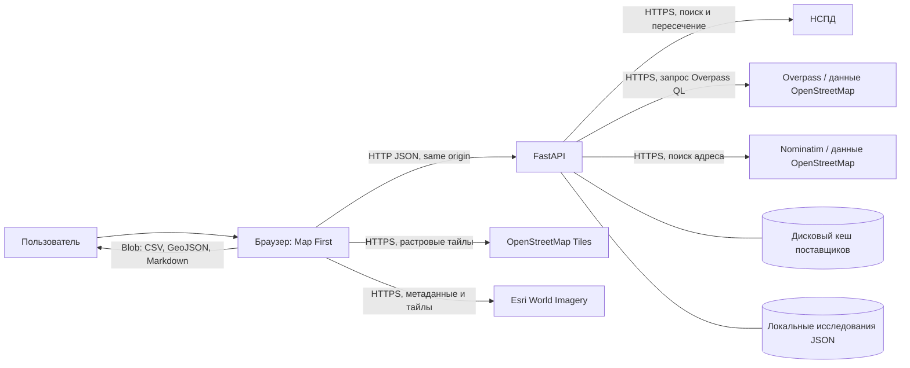

# Общее описание ЭкоГеоТерры

**Назначение** — описать рабочее место пользователя и границы системы.

ЭкоГеоТерра помогает вручную исследовать территорию. Пользователь выбирает исходный земельный участок либо ориентир по адресу или координатам, изучает кадастровые контуры и объекты OpenStreetMap, сохраняет рабочее исследование и выгружает результаты.

| Статус | Возможность |
|---|---|
| Реализовано в Map First | Поиск точного кадастрового номера, адреса с выбором варианта или координат WGS 84. Для точки доступен отдельный поиск кадастровых кандидатов. Источник подтверждает пользователь. |
| Реализовано в Map First | Кадастровый буфер от полного контура, соседи, подписи, заливка по категориям, выбор объекта и минимальное расстояние между границами. |
| Предусмотрено конфигурацией | Основной API принимает 500, 1000 и 2000 м. Штатный `start.ps1` на 8000 допускает все три радиуса. Прямой запуск Uvicorn без флагов допускает 500 м. |
| Реализовано в Map First | Самостоятельная загрузка объектов OSM от точки, девять категорий, фильтры, выбор, CSV и GeoJSON. OSM и кадастр имеют отдельные радиусы. |
| Реализовано в Map First | Поиск ООПТ вокруг выбранной точки. Список и круговая карта показывают контуры и расстояния. Карточка загружает дополнительные реестровые сведения по действию пользователя. [CR-011.1](../CR-011.1/README.md) |
| Реализовано в Map First | OSM или Esri World Imagery, атрибуция активных источников, независимые слои, сворачиваемые панели и режим «Вся карта». Esri зависит от браузерного ключа и сервиса. |
| Реализовано в Map First | Несколько исследований на диске и один серверный активный UUID на каталог, автосохранение с ревизиями, восстановление после перезапуска. |
| Реализовано в Map First | Все кадастровые соседи и предварительный отбор по ВРИ как два отчёта, просмотр и Markdown. |
| Маршруты страниц | `/` и `/map` открывают Map First. С CR-008.1 URL прежних интерфейсов возвращают HTTP 404. |
| Вне текущей реализации | Общая рабочая область с авторизацией и раздельными пользователями, неизменяемые снимки, история ревизий, удаление исследования из UI, DOCX и автоматическое экологическое заключение. |

Backend — Python 3.12, FastAPI/Uvicorn, Pydantic, HTTPX, Shapely, pyproj, `pynspd`. Браузер — HTML/CSS и ES modules, локальные Leaflet 1.9.4 и Esri Leaflet 3.0.19. Backend проверяет вход, обращается к поставщикам, рассчитывает геометрию, хранит исследования и формирует строки отчёта. Браузер управляет картой, фильтрами и скачиванием. Данные хранятся в файловой системе без СУБД и очереди сообщений.

НСПД предоставляет сведения и контуры кадастра. Overpass возвращает объекты и теги OSM. Nominatim возвращает адресные варианты на данных OSM. Тайлы OSM и Esri идут напрямую в браузер. Код отслеживает признаки усечения НСПД, а полнота обычной выдачи остаётся неподтверждённой. Классификация OSM по тегам не устанавливает ВРИ, предварительный отбор по ВРИ требует проверки фактического использования и применимых норм.

## Контекст

**Код** — [main.py](../../app/main.py), [Map First](../../app/static/map-first/main.js), [хранилище](../../app/research_store.py), [отчёты](../../app/land_reports.py).

**Связанные документы** — [структура](01_PROJECT_STRUCTURE.md), [компоненты](02_COMPONENT_ARCHITECTURE.md), [интеграции](03_INTEGRATION_DESIGN.md), [запуск](08_DEPLOYMENT.md), [диаграмма](diagrams/system-context.mmd).
