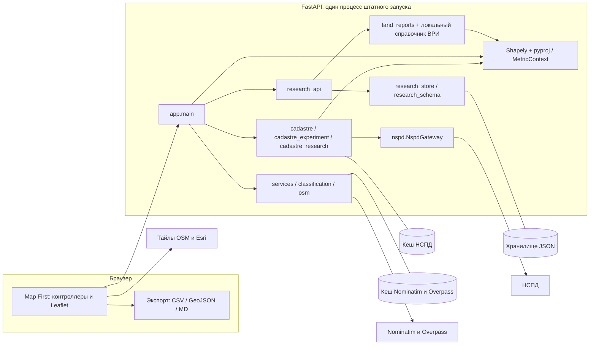

# Компонентная архитектура

**Назначение** — определить ответственность компонентов, их контракты и границы исполнения.

| Компонент | Вход → выход | Модули и зависимости | Обработка ошибок |
|---|---|---|---|
| Web UI / Map First | Ввод, события карты, JSON → Leaflet, панели, текущее состояние | `main.js`, `interface.js`, `cadastre-map.js`, `point-candidates.js`, `osm-map.js` и контроллеры | `request.js` распаковывает ошибки; неудачный или запоздавший ответ не подменяет принятую кадастровую выборку. Предыдущая OSM-выборка помечается отдельно. |
| Backend API | HTTP JSON/Query → GeoJSON, состояние, ошибки, HTML/статика | `app.main`; `research_api` и Pydantic; часть ответов собрана из словарей | Стандартные 422 и `detail`; новый кадастровый маршрут добавляет `detail.code`, `coverage` и `request_id`. |
| Кадастровые сервисы | Номер, точка или контур и допущенный радиус → участки, кандидаты, буфер, измерения | `CadastreService`, `CadastreExperiment`, `CadastreResearch`, один шлюз `NspdGateway` и общий lock в процессе | Признаки усечения ведут к отказу. Проверенные контуры при локальных пропусках могут вернуться с `coverage=partial`. |
| Исследование ООПТ | Нынешняя опорная точка и диаметр → круговой запрос, расстояния и контуры для SVG | `oopt.py`, `oopt.js`, `oopt-map.js`; существующие `MetricContext`, защищённый `NspdGateway`, блокировка и пауза НСПД | При смене точки запоздавший ответ игнорируется. Подтверждённое усечение ответа даёт ошибку, локальные пропуски помечаются как частичное покрытие. |
| Геометрический движок | Координаты и CRS → валидный WGS 84, метры, пространственные отношения | `wgs84_geometry`, `buffer_geometry`, `parcel_measurement`, `MetricContext`, `element_geometry`, Shapely и pyproj | Некорректный исходный контур блокирует исследование. Некорректные соседние и OSM-геометрии учитываются по правилам потока. |
| OSM | Точка, радиус → Overpass QL → GeoJSON с категорией, румбом и ближайшей точкой | `services.fetch_objects/build_query`, `classification.classify`, `osm.element_geometry`, `main.analyze` | HTTP 429/504/502, частичный ответ с `remark` отбрасывается. Некорректные геометрии отдельных объектов пропускаются. |
| Геокодирование | Текст → варианты адреса с координатами | `services.geocode`, `search.js`, Nominatim | Пустой список имеет HTTP 200. Ошибки сети и формата показываются отдельно. |
| Кеш поставщиков | Ключ и параметры → свежий JSON либо внешний запрос | `CachedService` для сырых Nominatim/Overpass; `CadastreService` и `CadastreResearch` для кадастра | Повреждённый или просроченный кеш пропускается. Ошибка записи кеша может оставить пригодный ответ операции. |
| Хранилище | UUID, ревизия, состояние и выборки → согласованные JSON | `ResearchStore`, `Manifest`, `clean_cadastre`, `clean_osm`, блокировка каталога | 409 при конфликте активного UUID или ревизии, 413 при превышении объёма, 422 при повреждении, 503 при I/O. |
| Отчёты | Согласованная сохранённая ревизия кадастра → массивы `all` и `normalized` | `get_land_reports`, `ResearchStore.active_cadastre`, `land_reports.build_reports`, локальные правила ВРИ и WGS 84 | Без выборки `report:null`. Невалидный источник/буфер блокирует отчёт; дефектные соседи снижают полноту. |
| Экспорт | Выбранная таблица отчёта или отфильтрованные OSM-объекты → файл | `land-reports.js` и `osm-export.js`. Blob и object URL | Кнопки недоступны без подходящего набора. HTTP-маршрутов экспорта нет. |

Браузер получает JSON и статику с того же origin. НСПД, Nominatim и Overpass вызываются backend. Подложки идут напрямую из браузера. При Esri браузер передаёт предоставленный ключ сервису. Маршруты, схемы и снимок статики инициализируются одним процессом. `/`, `/map` и `/static` используют этот снимок до следующего запуска. HTML и статические ресурсы отдаются с `Cache-Control: no-store`. После перезапуска обновите уже открытую вкладку.

Внешние интеграции и кадастровый single-flight ограничиваются в пределах процесса. Блокировка хранилища действует на процессы с общим каталогом. Для отчёта блокировка удерживается при чтении манифеста и кадастра, после чего строятся таблицы по прочитанному снимку.

**Код** — [FastAPI](../../app/main.py), [router исследований](../../app/research_api.py), [таблица модулей](01_PROJECT_STRUCTURE.md).

**Связанные документы** — [контекст](00_SYSTEM_OVERVIEW.md), [интеграции](03_INTEGRATION_DESIGN.md), [модель данных](05_DATA_MODEL.md), [потоки](06_DATA_FLOWS.md), [диаграмма](diagrams/components.mmd).
