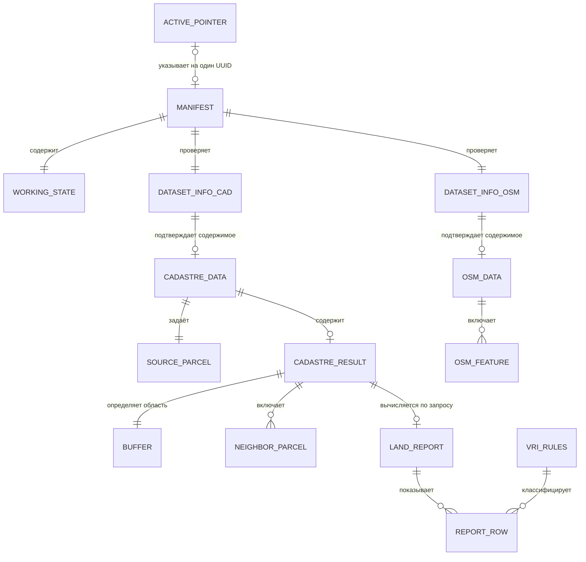

# Модель данных

**Назначение** — описать типы, источник и связи кадастровых, OSM и сохранённых данных. Полные синтетические JSON находятся в [справочнике API](04_API_REFERENCE.md).

Радиусы и расстояния заданы в метрах, площади — в м², координаты — в градусах WGS 84. Геометрии используют GeoJSON [longitude, latitude], объектные поля — {lat, lon}. Направление задаётся румбом, азимут OSM — градусы от севера по часовой стрелке. Даты поступления и сохранения формируются сервером в UTC, дата экспорта Markdown вычисляется отдельно.

## Кадастровые сущности

| Сущность / поле | Тип и обязательность | Источник и связь |
|---|---|---|
| Участок `type,id,geometry,properties` | `"Feature"`, кадастровый номер, Polygon/MultiPolygon, объект | `parcel_feature` из `properties.options` и геометрии НСПД, после конверсии CRS. `properties.number=id`. Исходный и сосед используют одну форму. |
| `land_category,permitted_use,address` | Строки или null в живом ответе; поля с null опускаются при сохранении | `land_properties`; ВРИ из `permitted_use_established_by_document`, адрес из `readable_address/address_readable_address`. |
| `category_bucket,area_m2,geometry_status` | Bucket settlement/industrial/agricultural/other/unknown, число или null, строка; допускается отсутствие в сохранённых данных | Bucket из нормализованной категории, площадь из учётных полей, статус описывает площадной контур. |
| `label_point` | `[lon,lat]`, опционально в сохранении | `representative_point`. Используется для подписи и как ориентир OSM при поиске номера. |
| `measurement` | Объект с `relation`, необязательные `distance_m` и `endpoints:[[lon,lat],[lon,lat]]` | `source` у исходника, `touches/intersects` с нулём, `disjoint` с ближайшими концами, `undefined` без пригодного измерения. Порядок концов исходный → сосед. |
| Контур | Геометрия GeoJSON с кольцами; Polygon/MultiPolygon | `wgs84_geometry` проверяет валидность, конечность и географические пределы; в файловой схеме также регламентированы форма и число координат. |
| Буфер | Feature с Polygon/MultiPolygon и `properties.radius_m` | `buffer_geometry` из полного исходного контура в AEQD, обратная проекция в WGS 84. Радиус совпадает с фактическим `result.radius_m`. |
| Выборка | `source:Feature`, `buffer:Feature`, `parcels:FeatureCollection`, `stats:object`, `radius_m:int`, `retrieved_at:string`, `cache_hit:bool`, `coverage`, `warnings:list[str]` | Основной маршрут также возвращает `source_revision`, SHA-256 нормализованного WKB + номер, и `coverage_details:{reason,confirmed,records_skipped}`. Соседи уникальны, исходный номер исключён. `stats` учитывает вход, валидную геометрию, нанесённые/соседние, категории, пропуски, внешние и дубликаты, время подготовки. |
| Кандидат по точке | `{number,relation,distance_m,parcel}`; у непроверенного также `properties` | `point_candidates`: inside/boundary с null-расстоянием, near с метрами, unverified с `parcel:null`. Проверенный «кандидат» становится источником только после команды пользователя. |
| Legacy кандидат обогащения | `id,cadastral_number,category_id,object_type,characteristics,raw_options,geometry,geometry_crs,source_crs,match_basis,spatial_relation,intersection` | `cadastre.candidate`; варианты данных земли и ОКС. `geometry` может быть null, `intersection` присутствует как объект только в полигональном совпадении. Возвращается в `EnrichResponse.candidates`; не записывается в исследование. |

`coverage` новой принятой выборки имеет `unknown` либо `partial`. Контракты чтения/рендера также поддерживают `complete`. Явное усечение внешнего ответа — HTTP-ошибка, а не принятая таблица. Фактический радиус результата хранится отдельно от текущего значения переключателя.

## OSM и адреса

| Структура | Поля и типы | Источник и связь |
|---|---|---|
| OSM Feature | `type="Feature"`, `id="node/…", "way/…" или "relation/…"`, `geometry`, `properties` | От `main.analyze`. Геометрия из элементов Overpass; типовые результаты Point, LineString, Polygon, MultiPolygon. File validator также допускает MultiPoint/MultiLineString. |
| OSM свойства | `osm_type,osm_id:int,osm_key,name,has_name:bool,category,type,classification_basis,tags:dict`; `distance_m:number`, `direction:string/null`, `bearing_deg:number/null`, `nearest_point:{lat,lon}` | Идентичность и теги поставщика, категория по первому правилу, ближайшая точка и направление из `MetricContext.measure`. Имя `name:ru`/`name` или «Без названия». |
| OSM метаданные | `source` с lat/lon/radius/source_label, `total`, `counts`, `cache`, `osm_base_timestamp`, `projection`, `distance_method`, `warnings`, `skipped_geometry`, `attribution`, `disclaimer` | `main.analyze`. Живой `cache` включает hit, fetched_at, endpoint, warning. При сохранении остаются только hit/fetched_at; total/counts пересчитываются. |
| Адресный результат | `display_name:string,lat:float,lon:float,osm_type,osm_id,class,type,address` | `services.geocode`. Помимо имени и координат поля из провайдера допускают отсутствующие значения; `address` по умолчанию {}. UI хранит выбранный текст и координаты, список кандидатов в файл не записывается. |

Ключ OSM выбирает объект в `state.osm_selected`. `osm_categories` и `hide_unnamed` управляют видимой выборкой, а `requested_categories` запоминает, какие категории были отмечены при принятии набора. Backend Overpass получает полный набор правил независимо от этой метки.

## Файлы исследования

`research.json` — манифест `Manifest`. Все изменения согласованы через атомарную замену манифеста и суммы наборов.

| Группа полей | Тип / обязательность | Значение |
|---|---|---|
| `id,title,manual_title` | UUID в JSON-строке, строка 1–600, boolean; обязательны | Серверный UUID, автоназвание или подтверждённое ручное имя. |
| `address,number` | Строка/null (адрес до 1000), CadastralNumber/null | Данные источника; номер обязан совпасть с кадастровым файлом. |
| `created_at,updated_at,schema_version,revision` | Строки ISO с зоной до 64, literal 1, int ≥1; обязательны | Создание на ревизии 1; успешный PUT увеличивает revision. Ревизия не хранит историю. |
| `state` | `WorkingState`, обязателен | Ввод и слои Map First, см. ниже. |
| `datasets` | Объект с обязательными ключами `cadastre,osm` | `DatasetInfo` содержит `sha256` (64 hex), `size` (байты), `present`, опциональные `radius_m` и `retrieved_at`. Проверяется по содержимому. |

| Состояние `WorkingState` | Тип/по умолчанию |
|---|---|
| `camera`, `basemap`, `tab` | camera lat/lon/zoom, default 55/50/4; zoom 0–19, координаты ±90/±180. basemap osm/esri, default osm. tab cadastre/objects/oopt/coordinates, default cadastre. |
| `panel_open,map_only`, `layers` | false/false, флаги boundaries/labels true, fill/osm false. |
| `cadastre_radius,osm_radius` | Каждый 500/1000/2000, defaults 500/2000. Скачиваемые данные имеют собственный фактический радиус. |
| `osm_categories,hide_unnamed` | Уникальный список известных категорий до 9 или null, default null; false для фильтра безымянных. |
| `cadastre_selected,osm_selected` | Кадастровый номер или null; ключ `node/…`, `way/…`, `relation/…` или null. |
| `oopt_anchor` | `cadastre`, `osm`, `coordinates` или null (по умолчанию). Указывает, из какого имеющегося выбора восстанавливать точку для вкладки «Исследование». |
| `osm_origin,location,coordinates,query` | Две nullable точки lat/lon с необязательными label/address ≤1000, nullable точка с marker (default true), строка query до 500, default пустая. |

Модели состояния и входов строгие и запрещают неизвестные поля. Значения по умолчанию отрабатывают для отсутствующих полей. `PUT` передаёт очередной снимок `state`, а не patch состояния.

Выборка ООПТ и диаметр в манифесте не сохраняются. При открытии исследования восстанавливаются существующий выбор объекта и вкладка, а поиск ООПТ можно запустить снова с диаметром по умолчанию.

| Файл | Структура и обязательность |
|---|---|
| `cadastre.json` | Литеральный `null` либо `{source:Feature,result:null или object}`. `result` хранит buffer, parcels, radius_m, coverage, stats, retrieved_at, warnings и при наличии source_revision и coverage_details. Исходник включён один раз. `cache_hit` живого ответа отбрасывается. |
| `osm.json` | `null` либо `{result:FeatureCollection с metadata,requested_categories:list[str]}`. Восстанавливаются геометрии и теги из allowlist-полей, даты и отбор. Из тегов удаляются известные имена ключей секретов. |
| `active.json` | В корне, `{"id":null}` либо `{"id":"UUID"}`. Отсутствующий файл эквивалентен отсутствию активного исследования. |
| `.cadastre.previous`, `.osm.previous` | Временные версии для восстановления при прерванном commit. Содержимое принимается только с ожидаемыми длиной и SHA-256. |

## Отчёты и справочник ВРИ

`build_reports` возвращает `research:{title,source_number,revision}` и `report:null` либо `{radius_m,retrieved_at,coverage,invalid_contours,rules_version,all,normalized,classification_counts}`. Строка `all` имеет `number,category,use,direction,distance_m`. Последние четыре допускают null при отсутствии сведений. `normalized` добавляет `group`, `classification:matched/review`, `review_reason:string|null`. Для review в `group` сохранена текстовая форма со статусом для совместимости. `outside` учитывается в `classification_counts`, запись сохраняется в `all`.

[Справочник JSON](../../app/static/map-first/land-use-rules.v1.json) содержит `version`, `sources` (title/url), `groups` (label и entries code→name), `review` (reason и entries), `outside_selection` (code→name). `_rules` кеширует индекс в процессе. `_classification` сравнивает точный код, нормализованное имя или согласованную пару, без наследования по префиксу. Неизвестные и отсутствующие ВРИ остаются `review`. Отчёт проверяет пересечение сохранённого буфера, использует сохранённые расстояния, вычисляет румбы по прямому геодезическому азимуту между внутренними точками. Вывод расстояния в Markdown округляется до двух десятичных знаков с запятой; порядок основан на исходных метрах.

**Код** — [research_schema.py](../../app/research_schema.py), [research_store.py](../../app/research_store.py), [кадастровые поля](../../app/cadastre_experiment.py), [кандидат обогащения](../../app/cadastre.py), [OSM-результат](../../app/main.py), [отчёты](../../app/land_reports.py).

**Связанные документы** — [API](04_API_REFERENCE.md), [хранение](07_CACHING_AND_STORAGE.md), [спецификация отчётов и примеры](../CR-006/09_LAND_REPORTS.md).
