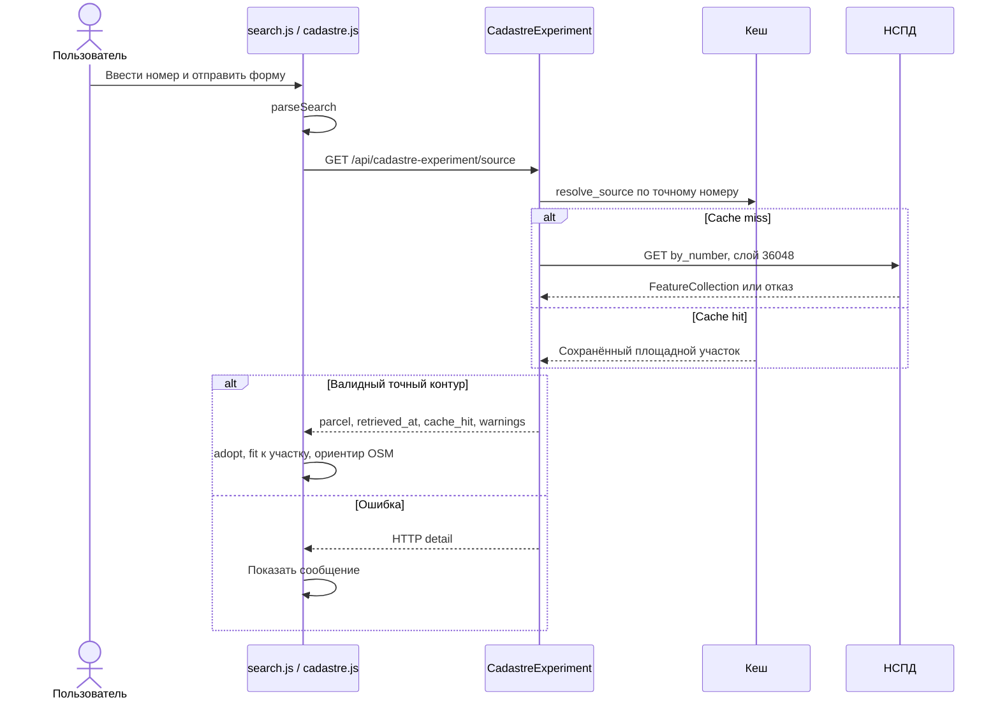
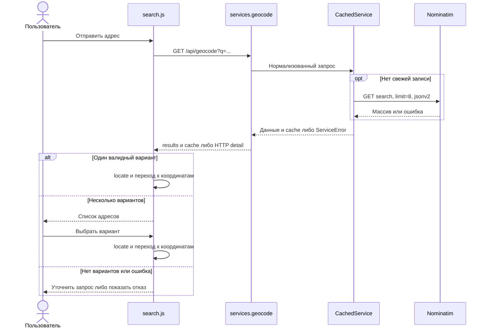
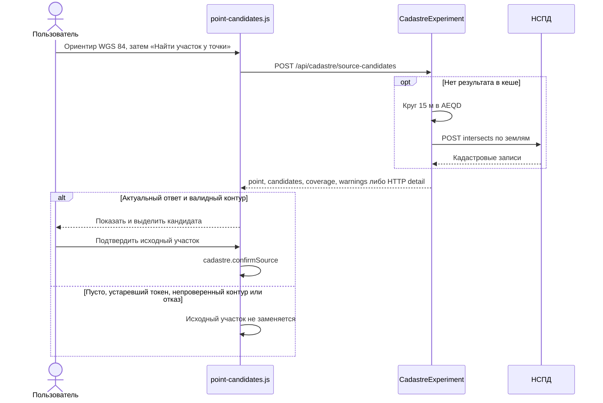
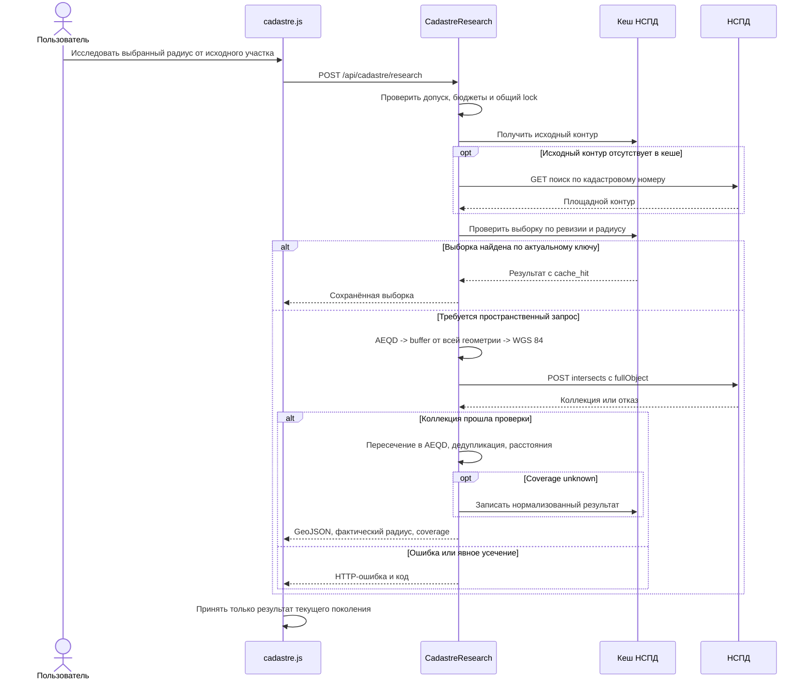
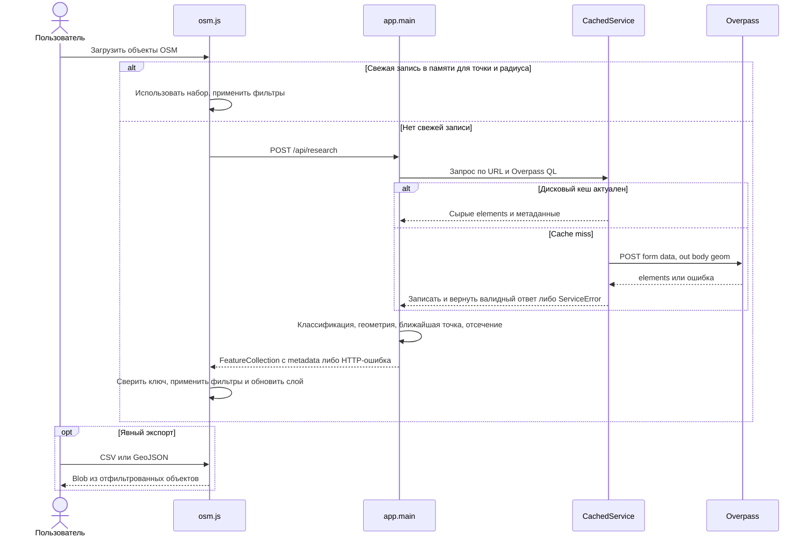
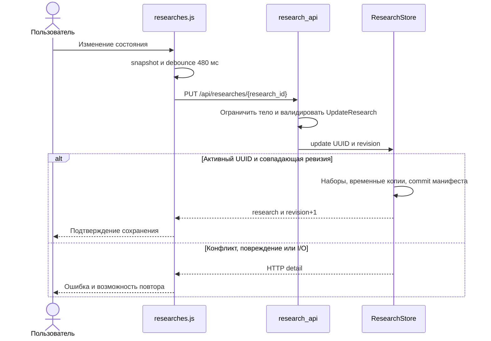
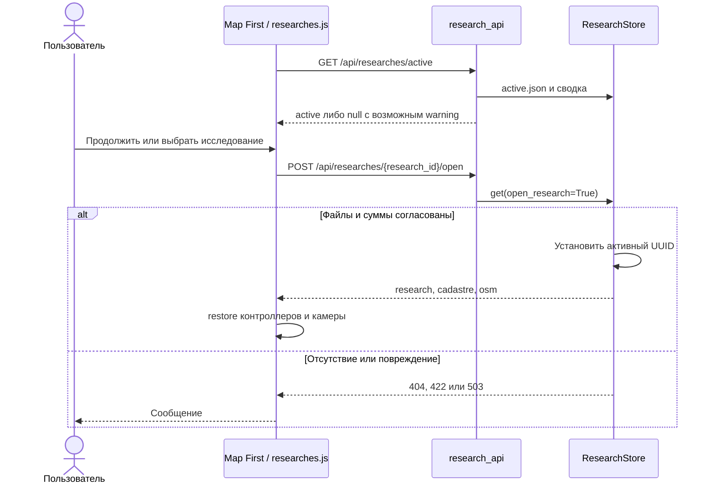
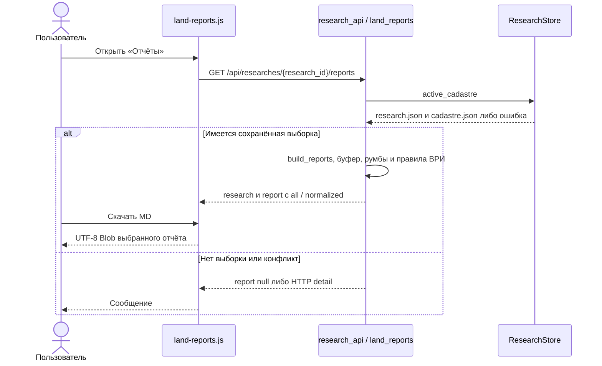

# Потоки данных

**Назначение** — показать последовательность основных операций, реальные точки входа и ветви восстановления.

## A. Поиск по кадастровому номеру

`parseSearch` распознаёт номер, `installSearch` вызывает `cadastre.findNumber`. `CadastreExperiment.execute` и `resolve_source` сначала смотрят локальный кеш; при miss шлюз `by_number` запрашивает площадной объект. `isParcel` проверяет ответ `{parcel,retrieved_at,cache_hit,warnings}`, затем `adopt` обновляет карту и ориентир OSM. Контур другого исходного номера очищает прежнюю кадастровую выборку. Синтаксическая ошибка не отправляет запрос, 404/невалидный контур сохраняют прежний контекст.

## B. Поиск по адресу

`searchAddress` вызывает `GET /api/geocode` с query `q`. `services.geocode` нормализует пробелы и возвращаемые типы. Клиент оставляет адреса с пригодными координатами, один результат выбирает сразу, при нескольких показывает список. `locate` и `coordinates.goTo` перемещают карту; ориентир передаётся поиску кандидатов и OSM. При пустом списке или ошибке исходный кадастровый контур не заменяется.

## C. Подбор участка у координат

Ввод координат или адреса создаёт ориентир. После «Найти участок у точки» `createPointSearch` отправляет `{lat,lon}`. `_source_candidates` читает собственный кеш либо строит круг 15 м и обращается к `search_land`. `point_candidates` возвращает проверенные и непроверенные варианты. Ответ предыдущего запроса игнорируется при смене ориентира. `confirmSource` вызывается только для проверенного контура после отдельного подтверждения. Отказ и отсутствие кандидатов не выбирают участок автоматически.

## D. Кадастровое исследование

`installCadastre` читает capabilities и допускает выбор радиуса. На явное действие отправляет `number,radius_m,source_revision?`. Основной маршрут проверяет исходник и кеш выборки, вызывает `buffer_geometry`, `land_collection` и `attach_display_data`. Ответ содержит `source,buffer,parcels,stats,radius_m,coverage` и сопутствующие метаданные. При сбое основной запрос не переотправляется через legacy. Fallback на фиксированные 500 м выбирается раньше, если нет пригодного capabilities. Новый набор применяется после проверки радиуса, геометрии, ревизии и текущего поколения. Успешное уведомление исчезает через пять секунд, постоянный индикатор отражает применённый радиус.

## E. OSM-исследование

`installOsm` собирает `lat,lon,radius,source_label` по текущему ориентиру и радиусу. `main.research` вызывает `fetch_objects`, затем `analyze`. После `FeatureCollection` контроллер сверяет параметры ответа и применяет локальные фильтры. Если ориентир изменился, ответ может остаться в кеше старого ключа. При отказе предыдущий набор остаётся доступен в панели с признаком несоответствия. Выгрузку получает `exportOsm` из отфильтрованных объектов.

## F. Автосохранение исследования

`main.snapshot` объединяет камеру, параметры и результаты. `schedule` в `researches.js` ждёт 480 мс. `savePending` последовательно отправляет `PUT` с `revision,state` и изменёнными наборами/названием. `research_api.payload` читает тело, `ResearchStore.update` проверяет активный ID/ревизию, записывает данные и манифест. Следующий PUT использует новую ревизию. При 409/422/503 неподтверждённое состояние остаётся в памяти; при переводе на другой UUID или закрытии незавершённое сохранение блокирует переход. «Сохранить сейчас» форсирует PUT.

## G. Восстановление после перезапуска

`GET /api/researches/active` возвращает сводку. По «Продолжить исследование» или выбору из `GET /api/researches` выполняется `POST …/open`. UI завершает сохранение прежнего состояния, если оно открыто. `ResearchStore.get(open_research=True)` проверяет файлы и устанавливает активный UUID. `main.restore` восстанавливает кадастр, OSM, поиск, координаты, слои, панели, камеру и подложку по `{research,cadastre,osm}`. Возможны локальные GET конфигурации и обычные запросы тайлов. НСПД, Overpass и Nominatim при восстановлении выборок не вызываются. Если манифест или набор повреждён, UI показывает отказ.

## H. Отчёты и Markdown

`installLandReports` читает `GET /api/researches/{research_id}/reports` один раз при открытии диалога. `active_cadastre` сверяет активный UUID и загружает манифест и кадастр. `build_reports` проверяет буфер, образует `all` и `normalized`, сортирует по расстоянию и номеру, классифицирует ВРИ и вычисляет румбы. UI видит одну сохранённую ревизию даже при несохранённом изменении. `markdown` форматирует строки выбранной вкладки в UTF-8, дата формирования добавляется при скачивании.

**Код** — [search.js](../../app/static/map-first/search.js), [point-candidates.js](../../app/static/map-first/point-candidates.js), [cadastre.js](../../app/static/map-first/cadastre.js), [osm.js](../../app/static/map-first/osm.js), [researches.js](../../app/static/map-first/researches.js), [land-reports.js](../../app/static/map-first/land-reports.js).

**Связанные документы** — [интеграции](03_INTEGRATION_DESIGN.md), [API](04_API_REFERENCE.md), [модель](05_DATA_MODEL.md), [кеш и хранение](07_CACHING_AND_STORAGE.md), [кадастр Mermaid](diagrams/cadastre-flow.mmd), [OSM Mermaid](diagrams/osm-flow.mmd).
