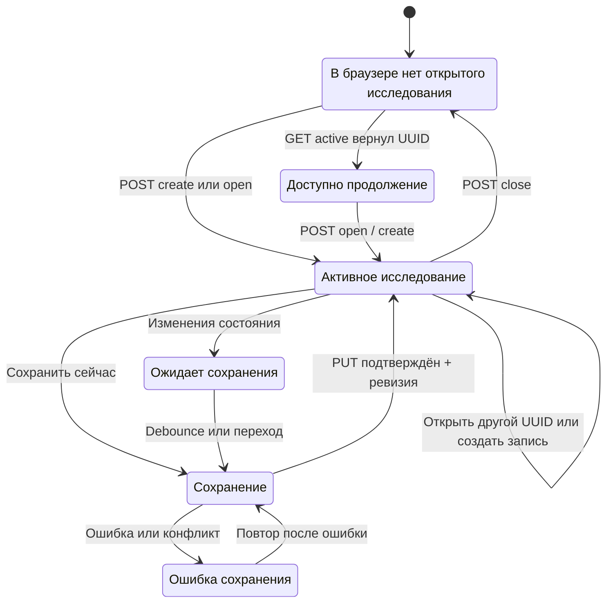

# Кеширование и хранение

**Назначение** — разделить временный кеш поставщиков, память браузера и долговременные файлы исследования.

## Внешние запросы

Все серверные кеши используют `CACHE_DIR` или путь из `services.default_cache_dir`. Для исходников это `<project>/.cache`, для EXE — `%LOCALAPPDATA%/EcoGeoTerra/cache` с резервом `~/AppData/Local`.

| Ветка и каталог | Что сохраняется | Ключ | TTL и очистка |
|---|---|---|---|
| `Nominatim` | `{saved_at,fetched_at,data}`, сырой JSON-массив адресов | SHA-256 сериализованных `[url,payload]`, сортировка ключей, нормализованный пробелами `q` | 7 дней, просроченное считается miss. Автоочистки нет. |
| `Overpass` | Такая же оболочка, валидный сырой `elements` и сопутствующие поля | SHA-256 URL и POST-параметров с полным Overpass QL; метод и User-Agent в ключ не входят | 24 ч, `remark` не кешируется. Автоочистки нет. |
| `NSPD`, обогащение | `{saved_at,result}` с нормализованным `EnrichResponse` для matched/multiple_matches/not_found | SHA-256 `["nspd-enrich-v1",endpoint,sorted(categories),payload.model_dump()]` | `NSPD_CACHE_TTL_SECONDS`, 86400 по умолчанию. |
| `NSPD`, исходный номер | `{saved_at,result}` с parcel, retrieved_at, warnings | `experiment-source-v1-{number_with_underscores}.json` | Тот же TTL; основной и старый API делят исходник. |
| `NSPD`, старые 500 м | Сформированный буфер и соседи; display-измерения добавляются после чтения | `experiment-buffer-v1-500-{sha256(WKB контура + номер)}.json` | Тот же TTL, отдельный от текущего bounded-запроса. |
| `NSPD`, кандидаты 15 м | Точка, кандидаты и метаданные | `experiment-point-v1-15-{sha256(repr(lat)+","+repr(lon))}.json` | Тот же TTL, ответы с предупреждениями не пишутся. |
| `NSPD/research-v2` | ASCII SHA-256 строки тела, перевод строки, UTF-8 JSON ответа, включая готовые измерения | SHA-256 массива из версии, базы/пути НСПД, категории, fullObject, номера, радиуса, ревизии и `ResearchLimits.data_profile()` | TTL по `mtime`. Проверяются байты, контрольная сумма, радиус, ревизия, coverage. При записи чистит устаревшие и вытесняет старые по mtime до лимита 512 МиБ по умолчанию. `partial` не пишется. |

Сырой кеш Nominatim/Overpass читается и записывается внутри одного lock на сервис. Совпавший запрос заново проверяет кеш после ожидания, что устраняет второй miss в одном процессе. `CadastreResearch.flights` явно объединяет одинаковые `(number,radius_m,source_revision)` в `Future`, общий lock последовательно допускает независимые кадастровые операции. Legacy-потоки при занятости возвращают отказ, без single-flight. Эти механизмы не разделяются между Uvicorn workers. Истёкший или нечитабельный кеш не подаётся как свежий при ошибке сети. Записи используют временный файл в том же каталоге и замену; на отказ записи кеша сервис может вернуть результат с предупреждением или запись в журнале. Лимит 512 МиБ относится только к `research-v2`, общая квота кеша не реализована.

## Память Map First

`osm.js` хранит до пяти записей в `Map` по точке (округление до 7 десятичных мест) и радиусу, свежесть 24 ч по `metadata.cache.fetched_at`. Повторный доступ обновляет порядок вытеснения; при смене исследования карта очищает этот кеш. Восстановленная выборка с совпадающим ключом может быть показана старше суток с предупреждением; явное обновление следует правилам свежести. Ответ прежнего ключа может попасть в память, но не рисуется как текущий. Данные и метаданные не хранятся в `localStorage`. Отдельного лимита байтов памяти браузера нет. Кадастр защищён счётчиком поколения, проверкой параметров/ревизии и подготовкой слоёв до замены. Кандидаты у точки используют токен текущей операции.

## Долговременные исследования

`RESEARCHES_DIR` указывает корень, по умолчанию `data/researches` от корня приложения. Папка `<UUID>/` содержит `research.json`, `cadastre.json` и `osm.json`, пустой набор обозначается JSON `null`. `active.json` в корне запоминает один активный UUID, `.lock` сериализует операции. Исследование не имеет TTL и остаётся после закрытия. Схема и связи в [модели данных](05_DATA_MODEL.md).

Изменения UI вызывают `schedule()` с задержкой 480 мс. PUT сериализованы, состояние передаётся с подтверждённой ревизией. Геометрия отправляется при смене набора, пропуск ключа оставляет его прежним. `update` нормализует переданные наборы, затем под блокировкой сверяет активный UUID и ревизию. Явное сохранение форсирует запись. Перед сменой исследования или закрытием UI ждёт подтверждения. Ошибка оставляет несохранённое состояние в памяти и позволяет повторить запись. `beforeunload` предупреждает при уходе с несохранёнными данными. После аварийного закрытия доступно последнее подтверждённое состояние.

`ResearchStore._locked` использует потоковый lock и локальную ОС-блокировку `msvcrt`/`fcntl`. `atomic_write` делает flush, fsync файла и `os.replace`. При изменении наборов `_commit` сохраняет предыдущие версии в `.<slot>.previous`, меняет наборы, последним заменяет манифест. При сбое пытается откатить данные. Читатель допускает основной файл или резерв только по SHA-256 и размеру в текущем манифесте. Успешные чтения проверяют схему, номер источника и согласованность метаданных. `POST …/open` обновляет указатель после проверки, `POST …/close` требует активную ревизию и сбрасывает указатель. Список пропускает битые манифесты, чтение повреждённого набора даёт 422; отказ диска — 503. После запуска UI предлагает продолжение, из хранилища восстанавливаются данные без НСПД, Overpass и Nominatim.

Пределы JSON: 256 КиБ для манифеста, 24 МиБ кадастр, 32 МиБ OSM. HTTP-тело до 57 МиБ + 256 КиБ. Набор до 15 000 Feature в коллекции, до 500 000 позиций с учётом исходника и буфера в кадастровом слоте. Каталог исследований в целом не имеет дисковой квоты, UI не удаляет исследования.

## Резервное копирование

Копировать весь корень `RESEARCHES_DIR` при остановленном собственном backend или из согласованного снимка файловой системы. Это сохраняет манифесты, оба набора каждого UUID, активный указатель и возможные `.previous` после аварии. `.lock` и временные `*.tmp` не являются самостоятельными данными. Кеш поставщиков можно переносить отдельно при необходимости; из него невозможно восстановить правки рабочего исследования. Ключи и конфигурацию хранить отдельно от копии данных.

**Код** — [services.py](../../app/services.py), [cadastre.py](../../app/cadastre.py), [cadastre_research.py](../../app/cadastre_research.py), [research_store.py](../../app/research_store.py), [researches.js](../../app/static/map-first/researches.js), [osm.js](../../app/static/map-first/osm.js).

**Связанные документы** — [модель](05_DATA_MODEL.md), [потоки](06_DATA_FLOWS.md), [развёртывание и перенос](08_DEPLOYMENT.md), [диаграмма](diagrams/research-lifecycle.mmd).
